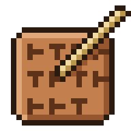

<p align="center"></p>

# nabu

**Nabu** /ˈnɑːbuː/ (NAH-boo)

*noun.* The Mesopotamian god of writing, scribes, and wisdom. Son of Marduk. Keeper of the Tablet of Destinies, where he wrote down the fate of gods and people.

---

A small CLI for spec-driven development, built around jj and stacked pull requests. Heavily inspired by [OpenSpec](https://github.com/Fission-AI/OpenSpec).

Work is planned in **tablets**. A tablet is one folder that holds the artifacts for one piece of work (`blueprint.md`, `tasks.md`).

## Built for jj and stacked PRs

- **One revision per slice.** `nabu-outline` splits a large feature into slices and creates one jj revision per slice. Each slice ships as one small, reviewable PR.
- **Edit any slice, the stack follows.** jj rebases descendants automatically. Fix slice 2 while you work on slice 5 => slices 3 to 5 pick up the fix at once. No `git rebase -i`, no restacking scripts.
- **One `stack.md` for the whole stack.** It lives in the stack revision at the bottom => every slice sees the same version. Edits made from any slice move down with one `jj squash`.
- **Pin -> act -> diff.** Before a subagent or tool runs, the skill pins the current commit. After it returns, the agent runs `jj diff --from <pin>` and sees exactly what changed. No long report from the subagent, no grepping through the code to confirm it.
- **Stacked PRs in one command.** `nabu-ship` opens one PR per slice, each based on the slice below. After an edit, rerun it: every restacked slice is pushed again.
- **Undo for free.** Every jj operation is logged. A bad agent run is one `jj op restore` away => every step is a dry run you can keep or drop.
- **No commit noise.** jj snapshots the working copy. Skills never commit as a side effect.

## Install

```sh
cargo install --git https://github.com/tzasadil/nabu
nabu init            # same as --global
nabu init --local    # per project setup
```

- `nabu init` installs into your home: skills in `~/.agents/skills/`, agents in `~/.claude/agents/`, and a link `~/.claude/skills` when missing. It writes a starter `~/.config/nabu/config.toml` when missing.
- `nabu init --local` installs into the current repo only: `.agents/skills/`, `.claude/agents/`, a link `.claude/skills`, and a starter `nabu/config.toml` when missing. Nothing outside the repo changes. The global config still applies.
- A rerun replaces every skill and agent nabu ships. Other skills and any existing config stay as they are.
- Init refuses to write through a symlinked skills or agents folder. This repo links them to its sources, so run `--local` in other repos.

## Goals

- **jj native.** Built for [jj](https://github.com/jj-vcs/jj). Git is not required.
- **Stacks first.** A tablet can hold a `stack.md`. The stack splits the tablet into slices, one subfolder per slice. The `stack.md` template lives with the other templates (`blueprint.md`, `tasks.md`).
- **Fully configurable.** Artifacts, templates, and rules come from config.
- **Global settings and templates.** Set them once in `~/.config/nabu/`. A repo overrides only what differs.
- **Self-learning.** `nabu-learn` mines past sessions for repeated corrections and friction. It turns them into learned rules and reviewer rules, plus ranked process improvements. Every rule cites the sessions it came from.
- **Templates in one place.** Skills get the current template from `nabu instructions`. No skill holds a copy of the default template.

## Extras

- **Backlog.** Each tablet keeps a `backlog.md` of deferred findings. The backlog never widens scope and never counts toward progress.

## What nabu avoids

- Hundreds or thousands of lines of spec before implementation starts. Such specs fill up with implementation details => no human can review them. They cost time and tokens and add nothing.
- WHEN/THEN scenario catalogues that state a simple contract in a bloated form.
- Bloated framework skills that force a heavy workflow (for example TDD) onto every small task.
- Git only.
- Commits after every step.
- No support for stacks.
- Default templates copied into every skill => one template edit means editing every skill.

## License

MIT
